# Windows 11 Installation on VMware Workstation Pro

A step-by-step guide to downloading the Windows 11 ISO, creating a virtual machine, configuring its hardware, and installing Windows 11 using VMware Workstation Pro.

## 📌 Project Type

Lab Setup | Virtualization | Windows Deployment | IT Support

## 🧰 Tools and Technologies

- VMware Workstation Pro
- Windows 11 ISO
- Virtual machine configuration
- Virtual disk management
- Virtualization technology (Intel VT-x / AMD-V)

## 📖 Overview

This project documents the Windows 11 virtual machine installation workflow using VMware Workstation Pro. It covers downloading the Windows 11 ISO, creating and configuring a virtual machine, attaching the ISO, installing Windows, and completing the initial setup.

Screenshots illustrate the installation workflow and configuration steps.

## ⬇️ Part 1: Download Windows 11 ISO

### Step 1: Visit the Official Microsoft Website

Visit the official [Windows 11 download page](https://www.microsoft.com/software-download/windows11).

### Step 2: Select the Windows 11 ISO

Navigate to the Windows 11 disk image (ISO) download section.

Select the appropriate edition, choose your preferred language, and download the 64-bit ISO file.

### Step 3: Verify the Download

Confirm that the ISO file has downloaded successfully and note its storage location.

## ⚙️ Part 2: Create a New Virtual Machine

### Step 4: Create a New Virtual Machine

1. Open VMware Workstation Pro.
2. Select **Create a New Virtual Machine**.
3. Choose **Typical (recommended)**.
4. Continue through the setup wizard.

### Step 5: Configure the Virtual Machine

Follow the wizard to configure the virtual machine.

If you choose to install the operating system later, select that option and continue.

### Step 6: Select the Guest Operating System

Choose the following options when available:

- Guest operating system: Microsoft Windows
- Version: Windows 11 x64

The available options may vary by VMware Workstation version.

### Step 7: Choose the Virtual Machine Name and Location

Enter a descriptive name, such as `Windows 11 VM`, and select a suitable storage location.

### Step 8: Allocate Virtual Disk Space

Choose an appropriate virtual disk size. A 60 GB disk is a practical starting point, although updates and additional applications may require more space.

Choose whether to store the virtual disk as a single file or split it into multiple files.

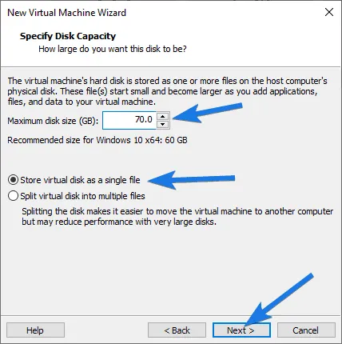

## 🔧 Part 3: Configure Virtual Hardware

### Step 9: Customize Hardware

Review the virtual machine hardware before starting it.

Suggested starting configuration:

- Memory: 4 GB minimum; 8 GB or more is preferable when available.
- Processor: 2 virtual processor cores as a starting point.
- Virtual disk: 60 GB or more.
- Network adapter: Choose the network mode appropriate for your lab.

Adjust these settings according to your host computer's available resources.

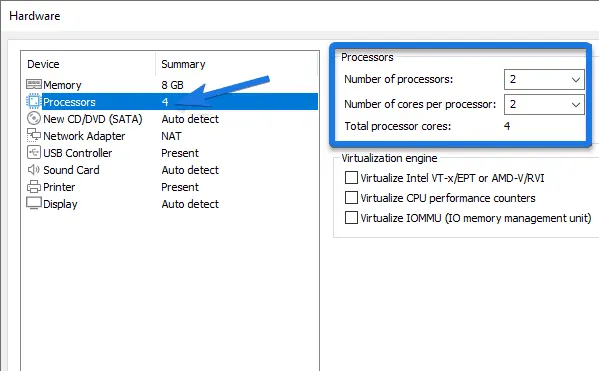

### Step 10: Attach the Windows 11 ISO

Open the virtual machine settings and locate the CD/DVD drive.

1. Select **Use ISO image file**.
2. Browse to the downloaded Windows 11 ISO.
3. Select the correct ISO file.
4. Confirm the settings.

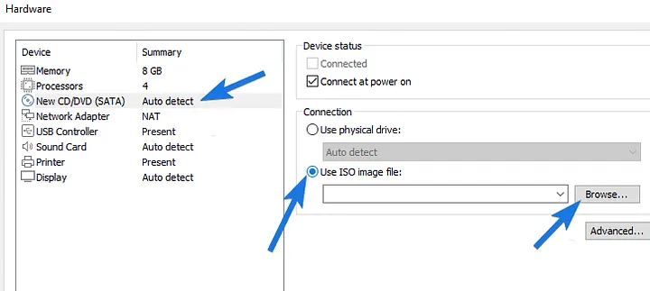

## 🪟 Part 4: Install Windows 11

### Step 11: Start the Virtual Machine

Power on the virtual machine and boot from the Windows installation media.

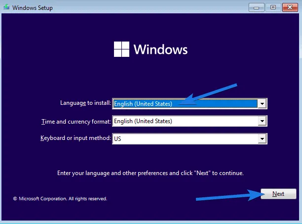

### Step 12: Enter the Product Key

Enter a valid product key if available. Otherwise, select **I don't have a product key** if offered.

Activation may be required later, depending on your license.

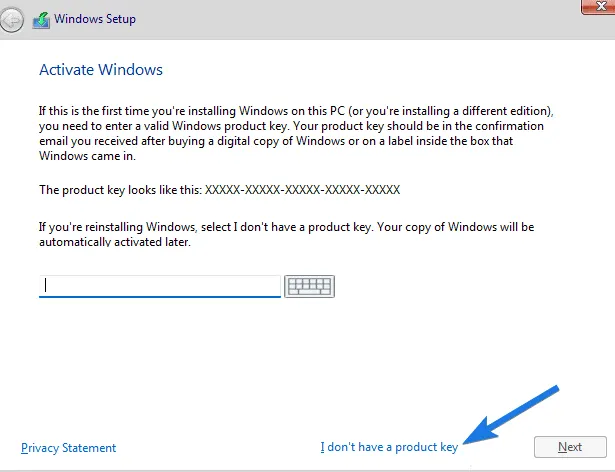

### Step 13: Select the Windows Edition

Select the edition appropriate for your license and intended use.

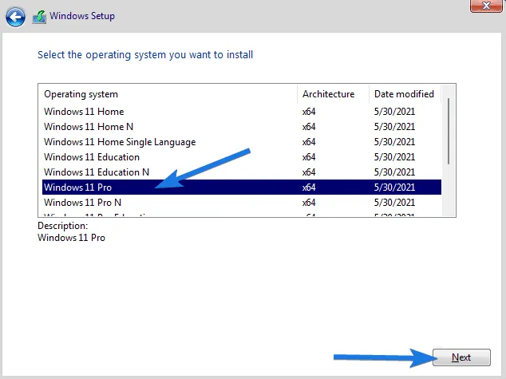

### Step 14: Accept the License Terms

Review and accept the applicable license terms to continue.

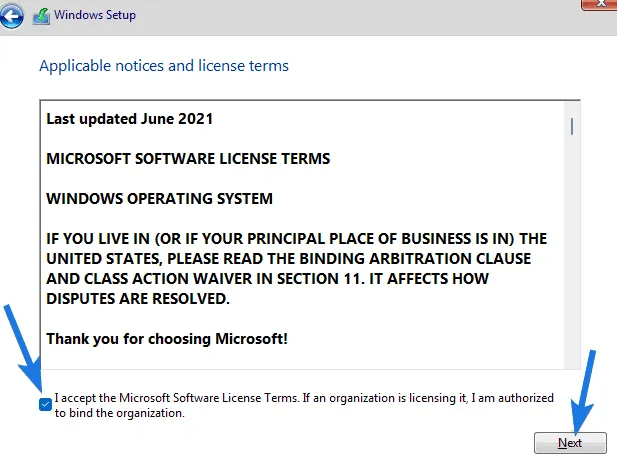

### Step 15: Choose the Installation Type

For a clean installation on the new virtual machine, select **Custom: Install Windows only (advanced)** when that option is available.

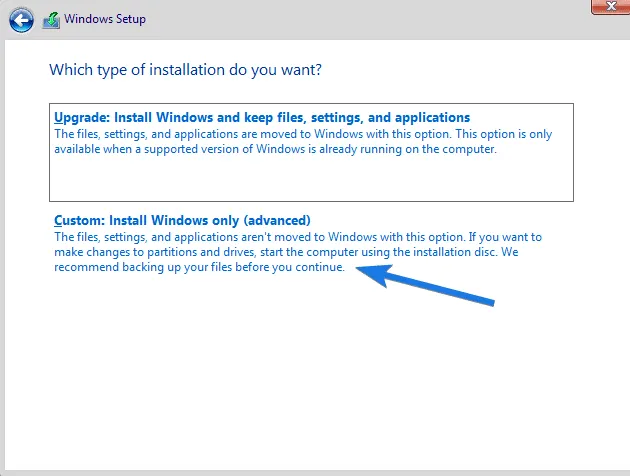

### Step 16: Configure Windows Setup

Follow the installation wizard and proceed through the setup screens.

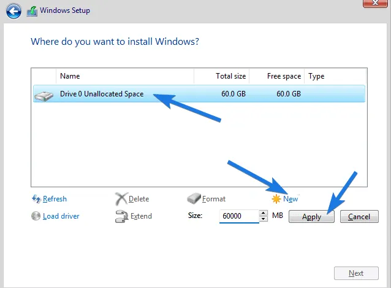

### Step 17: Select the Virtual Disk

Select the intended virtual disk or unallocated space for Windows installation. Confirm that you are working with the virtual machine's disk.

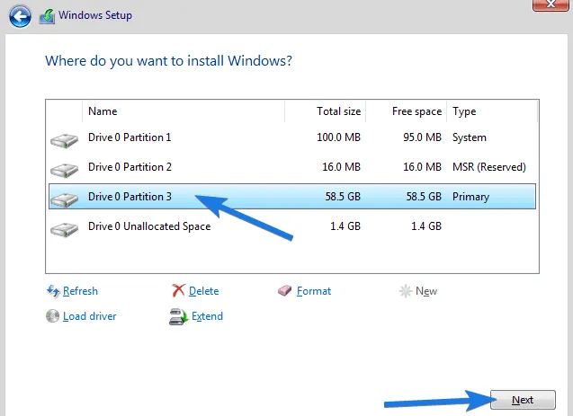

### Step 18: Wait for Installation

Allow Windows to copy files, install features, and restart as required. Installation time depends on the host computer and virtual machine configuration.

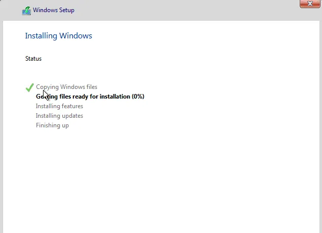

## 🌐 Part 5: Complete the Initial Setup

### Step 19: Configure Windows Settings

Complete the initial setup screens, which may include:

- Region and keyboard layout
- Network connection
- Microsoft account or available local account options
- Privacy and device settings

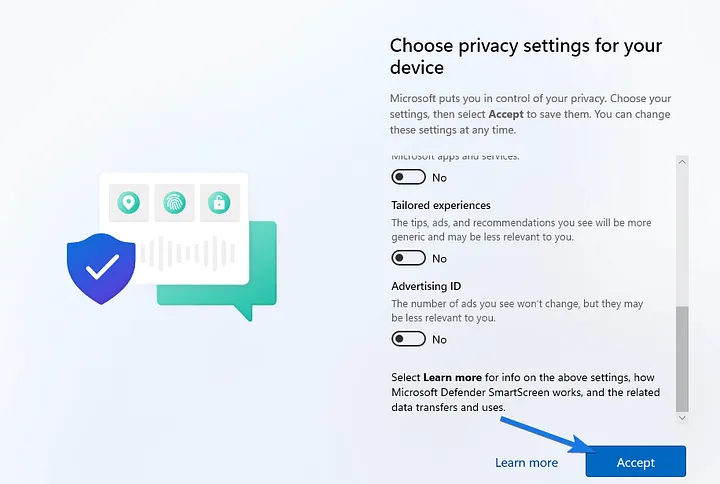

### Step 20: Verify the Windows 11 Virtual Machine

After setup, start the virtual machine and confirm that Windows loads correctly.

### Step 21: Final Verification

Review the final Windows environment and confirm that the virtual machine is ready for further configuration.

## 🛠️ Part 6: VMware Tools

Where supported and applicable, install VMware Tools from the VMware Workstation menu:

1. Select **VM → Install VMware Tools**.
2. Follow the installer instructions inside the guest operating system.
3. Restart the virtual machine if prompted.

VMware Tools can improve display integration, mouse handling, and other supported guest features.

## 🎯 Skills Demonstrated

This project documents practical work with:

- Virtual machine creation and configuration
- Windows 11 ISO selection and attachment
- Virtual CPU, memory, disk, and network settings
- Operating system installation
- Initial Windows configuration
- Basic virtualization troubleshooting

## 👨‍💻 Author

**Sameera Nazneen**

Aspiring IT Support Professional | Cybersecurity Learner
