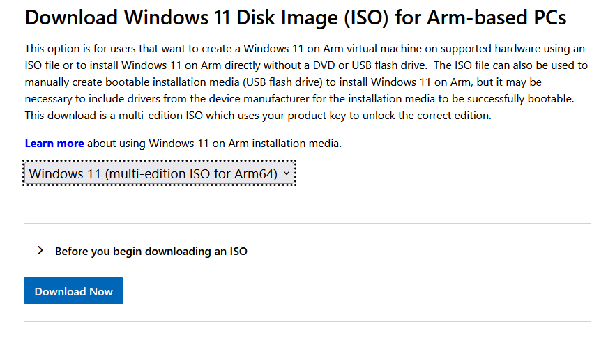
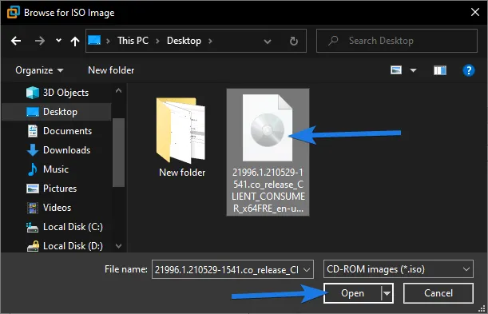
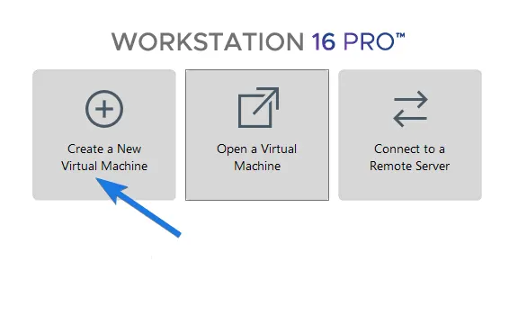
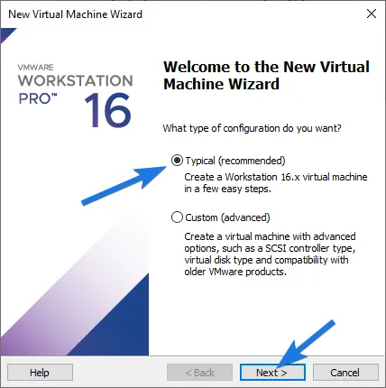
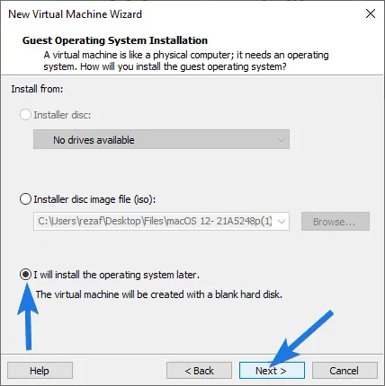
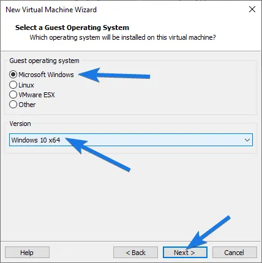
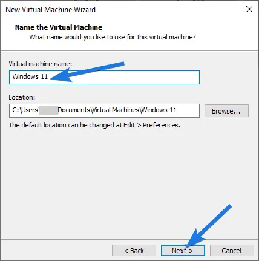

# Windows 11 Installation on VMware Workstation Pro

A step-by-step guide to downloading the Windows 11 ISO, creating a virtual machine, configuring its hardware, and installing Windows 11 using VMware Workstation Pro.

## 📌 Project Type

Lab Setup | Virtualization | Windows Deployment | IT Support

## 🧰 Tools and Technologies

- VMware Workstation Pro
- Windows 11 ISO
- Virtual machine configuration
- Virtual disk management
- Virtualization technology (Intel VT-x / AMD-V)

## 📖 Overview

This project documents the Windows 11 virtual machine installation workflow using VMware Workstation Pro. It covers downloading the Windows 11 ISO, creating and configuring a virtual machine, attaching the ISO, installing Windows, and completing the initial setup.

Screenshots illustrate the installation workflow and configuration steps.

## ⬇️ Part 1: Download Windows 11 ISO

### Step 1: Visit the Official Microsoft Website

Visit the official [Windows 11 download page](https://www.microsoft.com/software-download/windows11).

### Step 2: Select the Windows 11 ISO

Navigate to the Windows 11 disk image (ISO) download section.

Select the appropriate edition, choose your preferred language, and download the 64-bit ISO file.

### Step 3: Verify the Download

Confirm that the ISO file has downloaded successfully and note its storage location.

## ⚙️ Part 2: Create a New Virtual Machine

### Step 4: Create a New Virtual Machine

1. Open VMware Workstation Pro.
2. Select **Create a New Virtual Machine**.
3. Choose **Typical (recommended)**.
4. Continue through the setup wizard.

### Step 5: Configure the Virtual Machine

Follow the wizard to configure the virtual machine.

If you choose to install the operating system later, select that option and continue.

### Step 6: Select the Guest Operating System

Choose the following options when available:

- Guest operating system: Microsoft Windows
- Version: Windows 11 x64

The available options may vary by VMware Workstation version.

### Step 7: Choose the Virtual Machine Name and Location

Enter a descriptive name, such as `Windows 11 VM`, and select a suitable storage location.

### Step 8: Allocate Virtual Disk Space

Choose an appropriate virtual disk size. A 60 GB disk is a practical starting point, although updates and additional applications may require more space.

Choose whether to store the virtual disk as a single file or split it into multiple files.

![Virtual Disk Size](images/07-disk-size
